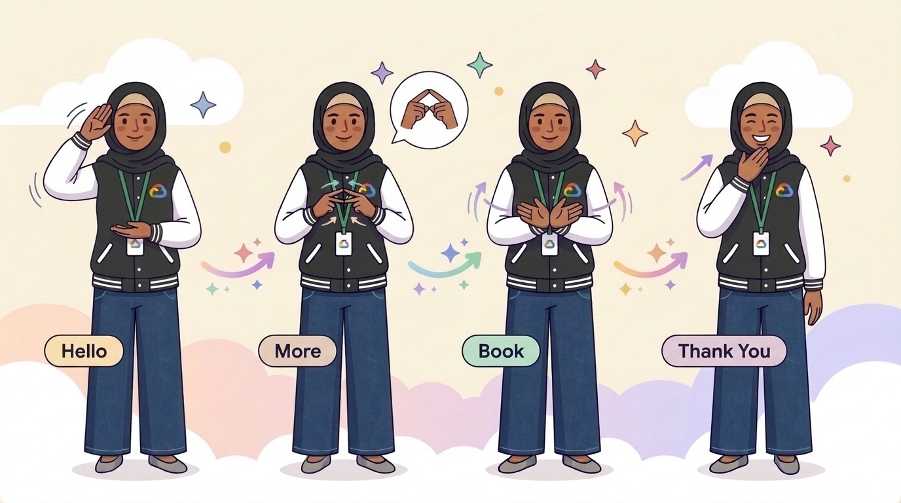
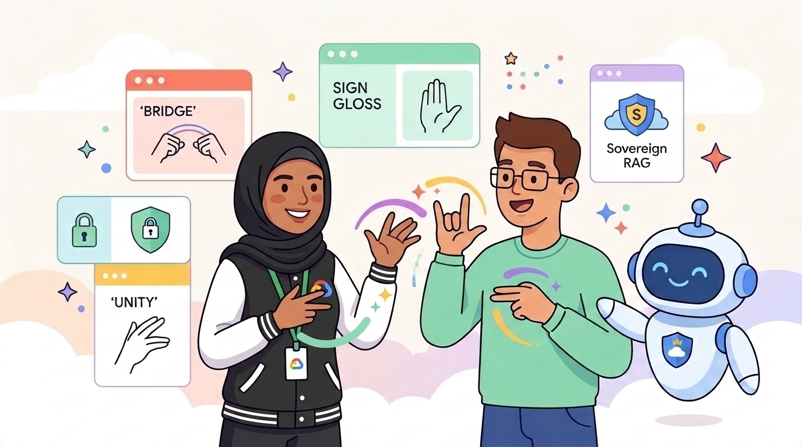
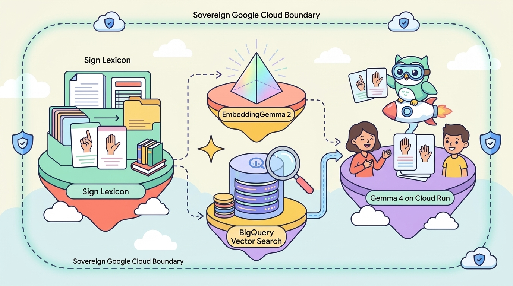
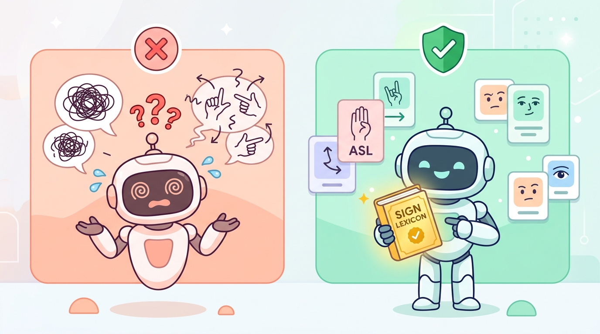

# SignBridge Sovereign RAG — Broadcast Media, Newsroom & Corporate Sign-Language Copilot



> **Google Cloud Codelab & Sovereign Reference Architecture (`signbridge-rag-agy#0`)**
>
> **Serverless Sovereign Stack:** Open-Weights **Gemma 4** on Cloud Run (L4 GPU + Auto CPU Fallback) · **EmbeddingGemma 2** (`768-d`) · **BigQuery Vector Search** (`COSINE`) · **FastAPI Side-by-Side Web UI** · **Google Antigravity CLI (`agy` + `/grill-me`)**

---

## 💡 1. Why SignBridge Was Built (The Problem We Solve)

Television news channels, digital media studios, and multinational corporations struggle to make live broadcasts and confidential internal communications accessible to **70M+ Deaf Sign Language users** because of three critical gaps:

1. **The Live-Air Time Crunch:** In a breaking TV newsroom or live executive Q&A, teleprompter scripts change **seconds before going live**. Studio Sign Language interpreters have zero time to manually look up complex financial (`150 basis points`), emergency (`flash flood`), legal (`NDA`), or technical signs.
2. **Catastrophic Idiom & Grammar Hallucinations in Generic AI:** Sign languages (**ASL**, **PSL — Pakistan Sign Language**, **BSL**) are *not* word-for-word English! They use 3D spatial **Topic-Comment** grammar, visual classifiers, and mandatory **Non-Manual Facial Grammar (`[brow-raise]`, `[brow-furrow]`, `[head-shake]`)**. Ungrounded LLMs translate English idioms literally (*"off the record"* becomes *"vinyl music record off table"*; *"fast 8 hours"* becomes *"run quickly"*), causing embarrassing or dangerous live-air mistakes.
3. **Strict Newsroom Embargoes & Corporate Data Sovereignty:** Pre-announcement quarterly earnings (`Q3` revenue), M&A town halls (*"zero layoffs"*), and embargoed press briefings contain **SEC Material Non-Public Information (MNPI)**. Media houses and corporations **cannot legally send** unreleased scripts to external third-party SaaS AI APIs. SignBridge keeps **every single model, vector, and prompt 100% inside your private Google Cloud boundary**.



---

## 👥 2. Who Will Use SignBridge & How They Use It

| Who Will Use It (Roles & Teams) | Real-World Scenario | How They Use SignBridge Step-by-Step |
| :--- | :--- | :--- |
| **📺 TV News Producers, Broadcast Directors & Studio Deaf Interpreters (CDIs)** | Breaking news tickers, election night desks, stock/central-bank updates (`150 bps`), severe weather alerts | Connect newsroom teleprompter software (ENPS / iNEWS webhook) to `/api/compare`. Verified ASL/PSL Gloss Cards + Classifier cues + Facial Grammar tags appear on the studio interpreter's confidence monitor before going live. |
| **🏢 Corporate Comms, Investor Relations (IR), HR & Legal Counsel** | Pre-earnings CEO rehearsals, confidential M&A employee town halls, global onboarding, NDA reviews | Paste embargoed executive speeches into the private Cloud Run Web UI inside the corporate VPC to generate audited **Interpreter Prep Packets** 24 hours before global livestreams—with zero external data leakage. |
| **🎬 Digital Media Houses, OTT Streaming Studios & Podcast Creators** | Accessible companion sign tracks, Deaf presenter scripts, regional educational/news shows | Upload the studio's approved **ASL / PSL / BSL Broadcast Style Guide** into BigQuery Vector Search via `vector_store/init_db.py` so every show and presenter uses standardized regional signs. |
| **🎓 Accessibility QA Leads & Sign Interpreter Trainers** | Onboarding junior broadcast/corporate interpreters & auditing AI accessibility tools | Use the **Side-by-Side Comparison Web UI** as an interactive training simulator to spot English idiom traps and verify Non-Manual Facial Grammar before going on camera. |

---

## 🏗️ 3. Sovereign Serverless Architecture



```text
signbridge-sovereign-rag-agy/
├── assets/                # Custom colorful Codelab & UI illustrations
├── codelab/
│   ├── CODELAB.md         # Official claat-formatted Google Codelab (#0 to #8)
│   └── index.html         # Interactive browser Codelab viewer (#0 to #8)
├── embedding_model/       # EmbeddingGemma 2 microservice on Cloud Run
├── llm/                   # Open-weights Gemma 4 via Ollama on Cloud Run (L4 GPU + CPU fallback)
├── orchestration/         # FastAPI backend + Side-by-Side Comparison Web UI
├── vector_store/          # BigQuery Vector Search DDL, ASL/PSL Broadcast Corpus & init_db.py
├── tests/                 # Automated pytest verification suite (6/6 tests)
├── setup_env.sh           # GCP API & environment bootstrapper
└── cleanup.sh             # One-command Cloud Run & BigQuery teardown
```

---

## 🧪 4. How to Test This Lab (3 Easy Ways!)



### Level 1: Run Automated Unit & API Tests Locally (5 Seconds, Zero Cloud Cost)
Verifies corpus integrity, 768-d normalized embeddings, BigQuery `VECTOR_SEARCH` SQL generation, and side-by-side Newsroom/Corporate/Clinical endpoints:
```bash
uv run --with pytest --with fastapi --with httpx pytest tests/test_signbridge.py -v
```

### Level 2: Test the Interactive Side-by-Side Web UI & Codelab Locally (Zero Cloud Billing)
1. **Open the Step-by-Step Codelab Viewer (`#0`–`#8`):** Open [`codelab/index.html`](codelab/index.html) in any browser to click through Steps `1` to `9` just like `codelabs.developers.google.com`!
2. **Launch the Live Side-by-Side Comparison App on `localhost:8080`:**
   ```bash
   uv run --with fastapi --with "uvicorn[standard]" --with httpx uvicorn orchestration.app:app --port 8080
   ```
   Open `http://localhost:8080` and click the preset buttons (**Breaking News Flood Ticker**, **Embargoed Corporate Earnings & M&A**, **Financial TV Desk PSL 150 bps**, **Press Briefing Idiom Trap**) to compare **Ungrounded LLM** vs. **SignBridge Sovereign RAG** live!

### Level 3: Full End-to-End Sovereign Cloud Run + BigQuery Test (Google Cloud Shell)
```bash
export PROJECT_ID="your-gcp-project-id"
export REGION="europe-west1"

# 1. Enable APIs & launch Antigravity CLI (/grill-me)
source ./setup_env.sh
agy

# 2. Deploy Sovereign EmbeddingGemma 2 & populate BigQuery Vector Search
(cd embedding_model && ./cloud_run.sh)
export EMBEDDING_SERVICE_URL=$(gcloud run services describe signbridge-embeddinggemma --project="${PROJECT_ID}" --region="${REGION}" --format="value(status.url)")
python3 vector_store/init_db.py

# 3. Deploy Open-Weights Gemma 4 (auto-detects NVIDIA L4 GPU or 8-vCPU fallback) & Public UI
(cd llm && ./cloud_run.sh)
./orchestration/cloud_run.sh

# 4. Tear down when finished so you pay $0 ongoing!
./cleanup.sh
```
