summary: Build and Deploy a Sovereign Sign-Language RAG System for Broadcast Media, Newsrooms & Enterprises with Gemma 4, EmbeddingGemma 2, BigQuery Vector Search, and Antigravity
id: signbridge-rag-agy
categories: ai, cloud-run, bigquery, accessibility, rag
tags: gcp, gemma, antigravity, cloud-run, bigquery-vector-search, sign-language, media
status: Published
authors: Robina Mirbahar (Google Developer Expert — AI & Cloud)

# Build and Deploy a Sovereign Sign-Language RAG System with Gemma 4 and Antigravity

<!-- ------------------------ -->
## Introduction
Duration: 5

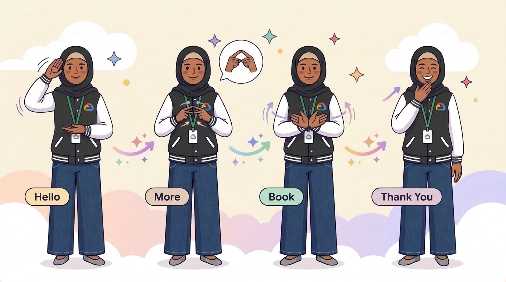

### Why SignBridge Was Built (The 3 Critical Gaps in Media & Enterprise Accessibility)
 SignBridge was built to solve an urgent gap faced by **television news channels, digital media studios, and corporate enterprises** trying to make live broadcasts and internal communications accessible to over **70 million Deaf Sign Language users worldwide**:

1. **The Live-Air Time Crunch:** In a breaking TV newsroom or live corporate Q&A, teleprompter scripts change **seconds before broadcast**. In-studio Deaf interpreters (CDIs) and accessibility producers have no safe way to instantly verify complex financial (`150 basis points`), legal (`NDA`), emergency (`flash flood`), or medical terminology across regional sign languages (**ASL, PSL — Pakistan Sign Language, BSL**).
2. **Why Generic AI Fails Sign Language:** Sign languages are **not** English on the hands—they use spatial 3D **Topic-Comment** grammar, visual classifiers, and mandatory **Non-Manual Facial Grammar (`[brow-raise]`, `[brow-furrow]`, `[head-shake]`)**. Off-the-shelf ungrounded LLMs translate English idioms word-for-word (*"off the record"* becomes *"music vinyl record off table"*; *"fast 8 hours"* becomes *"run quickly"*), causing severe misinformation on live television.
3. **Strict Newsroom Embargoes & Corporate Sovereignty:** Pre-announcement quarterly earnings, M&A town halls, investigative journalism scripts, and HIPAA/ADA briefings contain **Material Non-Public Information (MNPI)**. Media networks and corporations **cannot legally send** embargoed scripts to external public AI APIs. SignBridge solves this by keeping **Gemma 4**, **EmbeddingGemma 2**, and **BigQuery Vector Search** **100% inside your private Google Cloud project**.

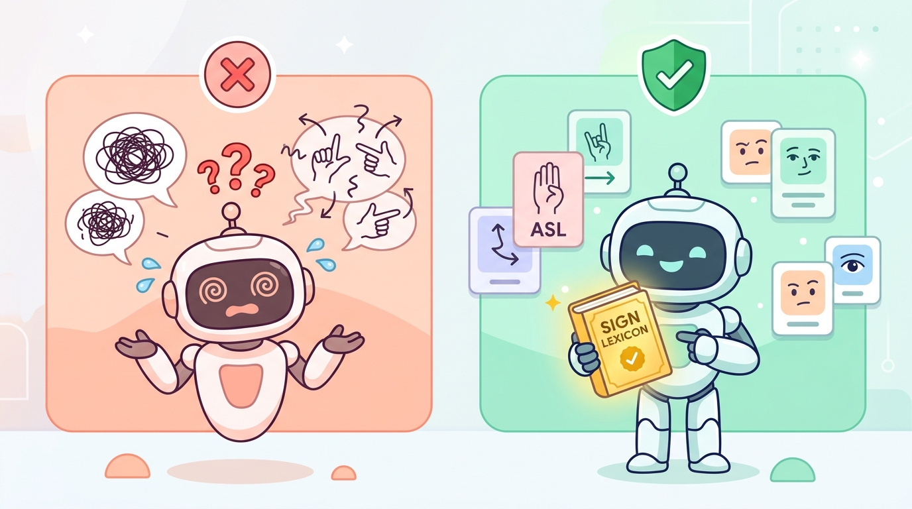

### Why RAG vs. Non-RAG Matters on Live Air & Corporate Stages
| Scenario | ❌ Non-RAG (Ungrounded LLM) | ✅ Sovereign RAG (`SignBridge`) |
| :--- | :--- | :--- |
| **Breaking Flood Ticker:** *"Flash flood evacuation—move to high ground"* | Signs literal English `CAMERA-FLASH` + `DIRT-FLOOR`, confusing Deaf viewers during an emergency | Retrieves verified Broadcast Gloss `WATER-RISE [CL:5-wave] EVACUATE HIGH-LAND GO-NOW` + urgent NMM |
| **Press Briefing:** *"This statement is off the record until 9 AM"* | Translates idiom literally as `VINYL MUSIC RECORD OFF-TABLE` on live air | Retrieves journalistic lexicon `[SL-MEDIA-004]`: `PUBLIC ANNOUNCE FORBID — LOCK-HOLD SECRET UNTIL 9 AM` |
| **Financial TV Desk (PSL):** *"Central Bank cut rates by 150 basis points"* | Outputs unintelligible `150 BASE DOTS` | Converts via broadcast style guide `[SL-MEDIA-003]` to visual `1.5-PERCENT CUT-DOWN` + inflation contrast |
| **Corporate M&A Town Hall:** *"Zero layoffs during the merger"* | Leaks confidential M&A script externally & drops negation timing | Runs **100% inside private GCP project**; enforces emphatic `[double-O-head-shake]` negation timing |

### Who Can Use SignBridge & How They Use It in Production
1. **📺 TV News Channels & Live Broadcast Desks — *How They Use It:***
   * News producers connect their newsroom teleprompter system (ENPS / iNEWS / webhook) to SignBridge's private `/api/compare` Cloud Run endpoint. As breaking tickers are typed, verified ASL/PSL Gloss Cards + Classifier cues + Facial Grammar tags appear directly on the studio interpreter's confidence monitor before the anchor speaks.
2. **🏢 Corporate Enterprises, Investor Relations & HR — *How They Use It:***
   * Executive Comms and IR teams paste pre-announcement CEO town hall speeches, quarterly earnings scripts, or HR/NDA policies into the sovereign SignBridge portal inside their corporate GCP boundary to generate audited **Interpreter Prep Packets** 24 hours before global livestreams—with zero external data leakage.
3. **🎬 Digital Media Houses, OTT Platforms & Studios — *How They Use It:***
   * Production teams upload their network's approved **Regional Sign Style Guide** (e.g., PSL financial/civic terms or ASL STEM terms) into BigQuery Vector Search via `vector_store/init_db.py`, ensuring every episode, documentary, and social clip uses consistent, culturally accurate signs.
4. **🎓 Interpreter Training & Broadcast QA Teams — *How They Use It:***
   * Accessibility leads use the **Side-by-Side Web UI** as an interactive training simulator to spot literal-English idiom traps and verify Non-Manual Facial Grammar before new interpreters go live on camera.

### What You'll Do
* Set up **Google Cloud Shell** and launch the **Google Antigravity CLI (`agy`)**.
* Use Antigravity's interactive `/grill-me` command to inspect GPU quotas and refine your sovereign serverless architecture.
* Deploy **EmbeddingGemma 2** (`768-d` dense embeddings) and **BigQuery Vector Search** (`VECTOR_SEARCH` with `COSINE` distance).
* Deploy open-weights **Gemma 4** on **Cloud Run** (with automatic NVIDIA L4 GPU detection + CPU fallback).
* Test the **Side-by-Side Broadcast & Corporate Comparison Web UI** on Cloud Run.

### What You'll Need
* A Google Cloud project with billing enabled.
* Access to Google Cloud Shell (or a local terminal with `gcloud` and `agy` installed).

---

<!-- ------------------------ -->
## Overview of the Application
Duration: 3

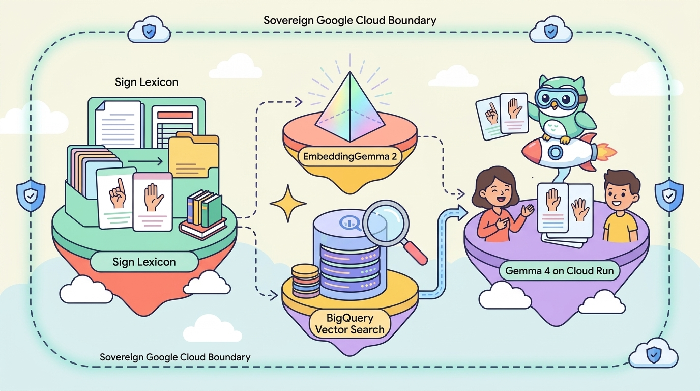

SignBridge is composed of **four sovereign components** running entirely inside your Google Cloud project boundary:

1. **`embedding_model/` (`EmbeddingGemma 2` on Cloud Run):** Converts broadcast style guides, corporate glossary rules, and live teleprompter prompts into 768-dimensional vectors using `embeddinggemma`—with zero external API calls.
2. **`vector_store/` (`BigQuery Vector Search`):** Stores your organization's verified ASL & PSL sign-language lexicon (`sign_lexicon_embeddings`) and executes low-latency `VECTOR_SEARCH(..., distance_type => 'COSINE')` queries.
3. **`llm/` (`Gemma 4` Open-Weights on Cloud Run):** Hosts open-weights `gemma4:e4b` via Ollama inside a private `--no-allow-unauthenticated` Cloud Run service (accelerating on an NVIDIA L4 GPU when quota is available, or seamlessly falling back to an 8-vCPU / 16 GiB CPU tier).
4. **`orchestration/` (`FastAPI` + Side-by-Side Web UI on Cloud Run):** Connects live user prompts to EmbeddingGemma 2, BigQuery Vector Search, and Gemma 4—rendering a side-by-side comparison between an **Ungrounded Baseline LLM** and **SignBridge Sovereign RAG**.

```text
signbridge-sovereign-rag-agy/
├── assets/                # Custom Codelab & UI illustrations
├── embedding_model/       # EmbeddingGemma 2 Cloud Run service (Dockerfile, app.py, cloud_run.sh)
├── llm/                   # Sovereign Gemma 4 Cloud Run service (GPU + CPU fallback)
├── orchestration/         # FastAPI backend + Side-by-Side Broadcast/Corporate Web UI
├── vector_store/          # BigQuery Vector Search DDL, corpus JSON & init_db.py
├── tests/                 # Automated pytest verification suite
├── setup_env.sh           # Project & API initialization script
└── cleanup.sh             # One-command resource teardown
```

---

<!-- ------------------------ -->
## Set up Cloud Shell and Antigravity CLI
Duration: 5

### Open Cloud Shell
1. Open the [Google Cloud Console](https://console.cloud.google.com/) and confirm your active project ID is selected:

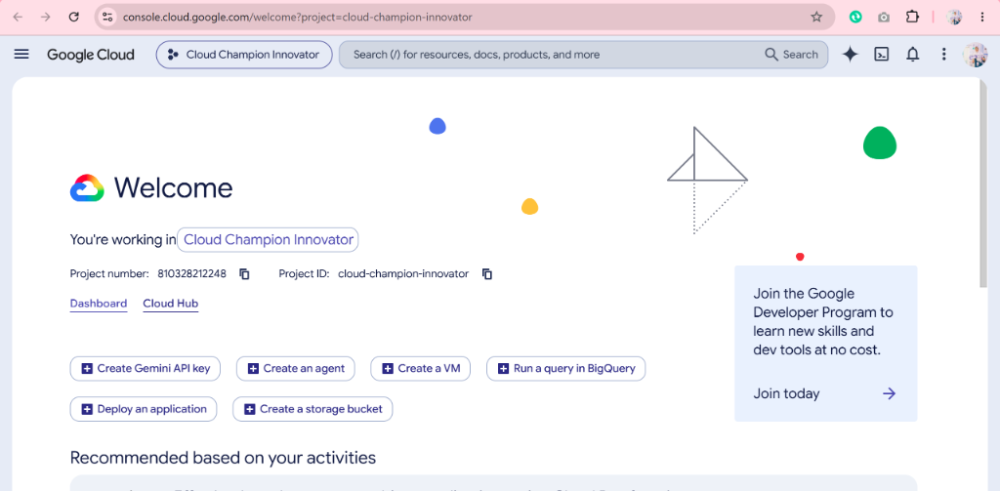

2. Click **Activate Cloud Shell** in the top-right toolbar and wait a few seconds while Cloud Shell provisions your machine:

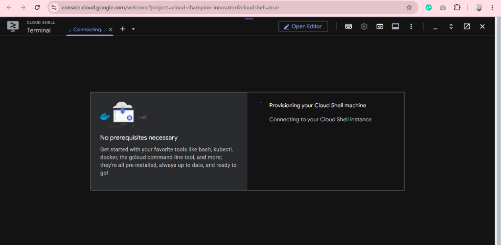

3. When prompted, click **Authorize** to grant Cloud Shell permission to run `gcloud` API calls:

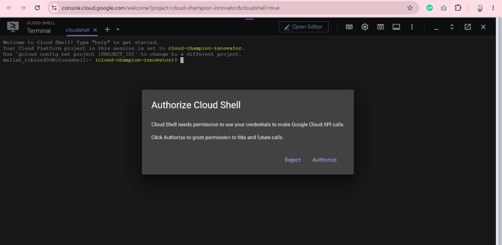

### Set Your Project and Enable Required APIs

> aside positive
> **Important — Replace with Your Own Project ID:** In the reference screenshots below, our demo Project ID is **`cloud-champion-innovator`**. When running the commands in your own Cloud Shell, replace `"cloud-champion-innovator"` with **your own Google Cloud Project ID** (or use `${GOOGLE_CLOUD_PROJECT}`, which automatically inserts your active Cloud Shell project ID).

Run the following commands to configure your session and enable Cloud Run, Cloud Build, Artifact Registry, and BigQuery:

```bash
export PROJECT_ID="${GOOGLE_CLOUD_PROJECT}"
export REGION="europe-west1"

gcloud config set project "${PROJECT_ID}" --quiet

gcloud services enable \
  run.googleapis.com \
  cloudbuild.googleapis.com \
  artifactregistry.googleapis.com \
  bigquery.googleapis.com \
  compute.googleapis.com \
  iam.googleapis.com \
  --project="${PROJECT_ID}" \
  --quiet
```

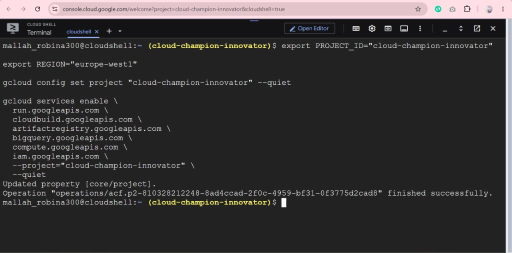

### Create Your Own Fresh Project Repository & Launch Antigravity CLI
Instead of cloning pre-written code, you will build your **own Sovereign RAG repository from scratch** using the **Google Antigravity CLI (`agy`)**! Create a clean directory, initialize Git, install `agy` (if not already pre-installed in Cloud Shell), and launch the interactive agent:

```bash
mkdir signbridge-sovereign-rag
cd signbridge-sovereign-rag
git init -b main

# Install Google Antigravity CLI and ensure ~/.local/bin is on PATH
curl -fsSL https://antigravity.google/cli/install.sh | bash
export PATH="$HOME/.local/bin:$PATH"

# Launch Antigravity inside your empty workspace
agy
```

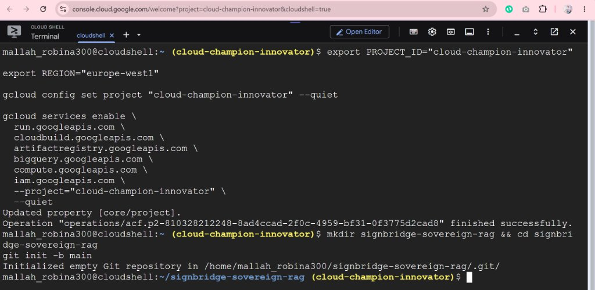

Antigravity CLI (`agy`) detects your Cloud Shell Linux environment (`linux_amd64`), downloads the latest release package, and launches the interactive colorful welcome screen:

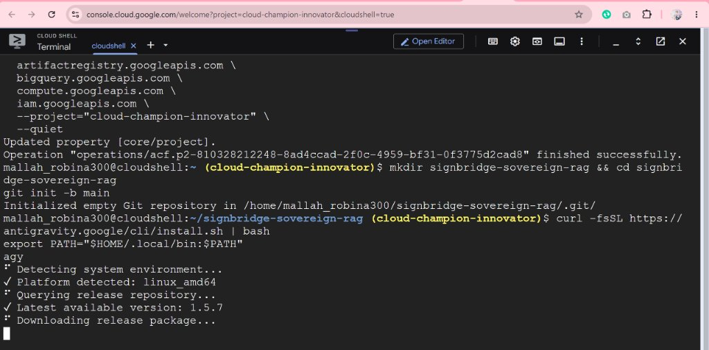

### Sign In to Antigravity CLI
On first launch, `agy` prompts you to choose a login method (`1. Google OAuth` or `2. Use a Google Cloud project`). Select **`1. Google OAuth`** (press **Enter**):

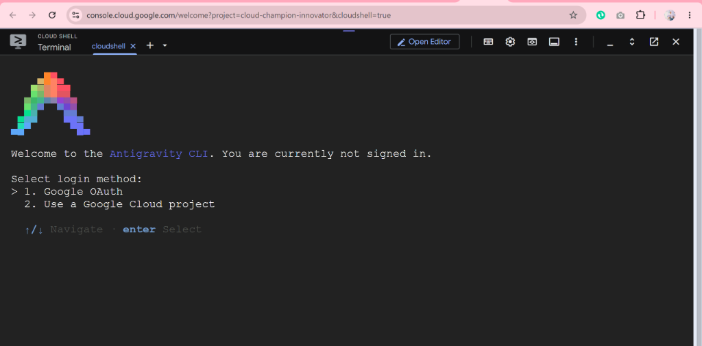

Click the `https://accounts.google.com/o/oauth2/...` link displayed in Cloud Shell to open Google Sign-In in a new browser tab:

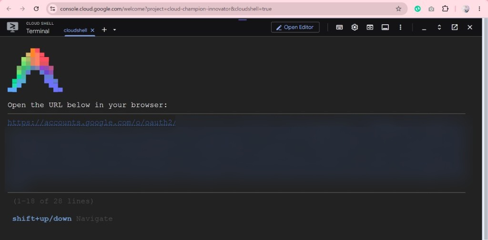

Copy the verification code from the **Google Antigravity** callback page, return to your **Cloud Shell** terminal, press **`Shift + Down Arrow`** to scroll to the `Paste the authorization code here:` input line at the bottom of the screen, paste the code, and press **Enter**:

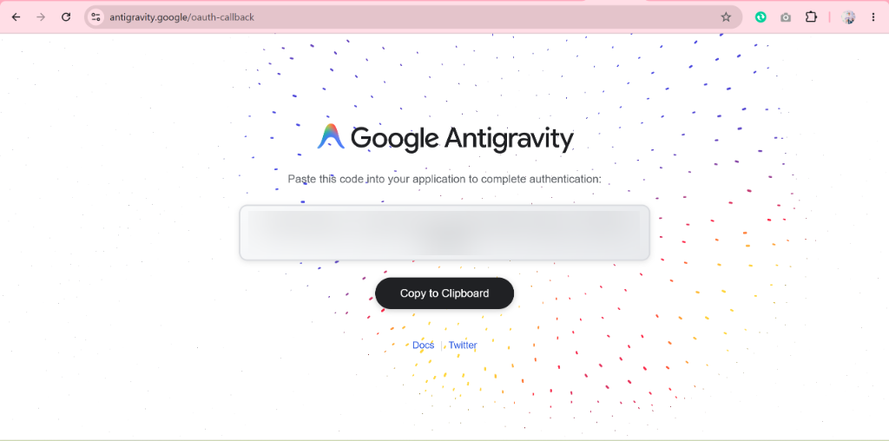

Once signed in, choose your preferred terminal color scheme (for example `dark` or `tokyo night`), navigate down to **`[Next]`**, and press **Enter** to open the interactive `agy` workspace prompt:

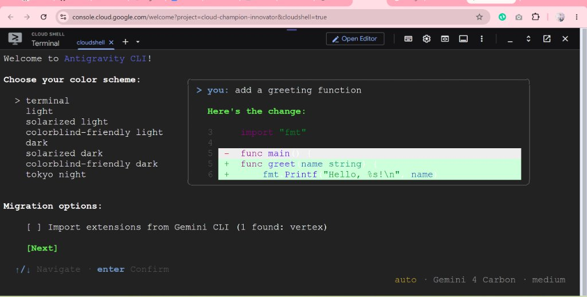

When prompted (`Do you trust the contents of this project?`), keep **`> Yes, I trust this folder`** selected and press **Enter**:

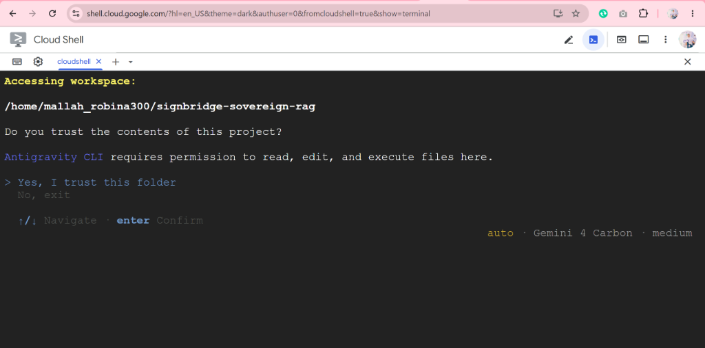

Your **Antigravity CLI 1.5.7** interactive prompt (`>`) is now live and ready inside `~/signbridge-sovereign-rag`:

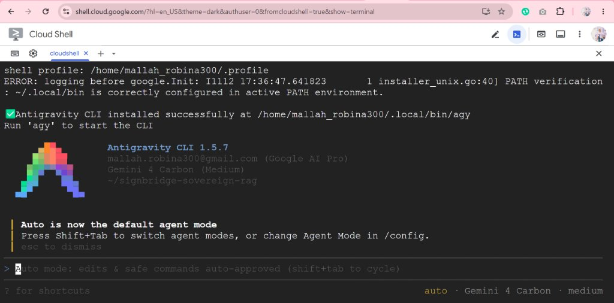

> aside positive
> **Tip:** Inside the `agy` terminal interface, you can type `/help` at any time to inspect built-in slash commands such as `/grill-me`, `/plan`, and `/compact`.

---

<!-- ------------------------ -->
## Plan the Architecture with Antigravity
Duration: 6

Before writing or deploying infrastructure, let's have Antigravity inspect our regional Cloud Run GPU quota and interview us on sovereign security constraints.

### Step 1: Inspect Your Environment and GPU Quota
In a separate terminal tab (or via Antigravity), check whether your target region (`europe-west1`) currently has `NVIDIA_L4` GPU quota allocated:

```bash
gcloud compute regions describe "${REGION}" \
  --project="${PROJECT_ID}" \
  --format="json(quotas)"
```

> aside negative
> **No GPU Quota? No Problem!** New Google Cloud projects often start with `0` regional GPU quota. Our `llm/cloud_run.sh` script automatically detects `limit=0` and falls back to an **8 vCPU / 16 GiB RAM** Cloud Run configuration so you can complete the entire Codelab without waiting for a quota increase!

### Step 2: Submit the `/grill-me` Architecture Prompt
Inside the **Antigravity CLI (`agy`)**, paste the following `/grill-me` prompt to align on architectural decisions before generating code:

```text
/grill-me We are building SignBridge, a Sovereign Sign-Language RAG system on Google Cloud for TV newsrooms and corporate town halls where pre-broadcast scripts must never leave our GCP project.
Stack:
1. EmbeddingGemma 2 on private Cloud Run
2. BigQuery Vector Search (COSINE distance) storing ASL & PSL broadcast sign glosses, handshapes, and Non-Manual Facial Grammar [NMM]
3. Open-weights Gemma 4 via Ollama on private Cloud Run (NVIDIA L4 GPU if quota >= 1, else 8-vCPU / 16Gi fallback)
4. Public FastAPI Cloud Run Web UI showing Side-by-Side Ungrounded LLM vs. Sovereign Grounded RAG.
Interview me on authentication boundaries, cold-start mitigation, and BigQuery schema choices before producing our implementation plan.
```

### Interactive Q&A & Reviewing the Implementation Plan
Answer Antigravity's clarifying questions:
* **Model Weights:** Pre-bake `embeddinggemma` and `gemma4:e4b` inside the container build step so runtime containers need zero outbound internet downloads.
* **Service-to-Service Security:** Deploy `embedding_model` and `llm` with `--no-allow-unauthenticated`; only the `orchestration` UI service is publicly reachable.
* **Chunk Structure:** Store structured columns (`verified_gloss`, `handshape`, `non_manual_markers`, `privacy_tier`) alongside `embedding ARRAY<FLOAT64>` in BigQuery so retrieved citations are deterministic and auditable.

---

<!-- ------------------------ -->
## Generate the RAG Application
Duration: 6

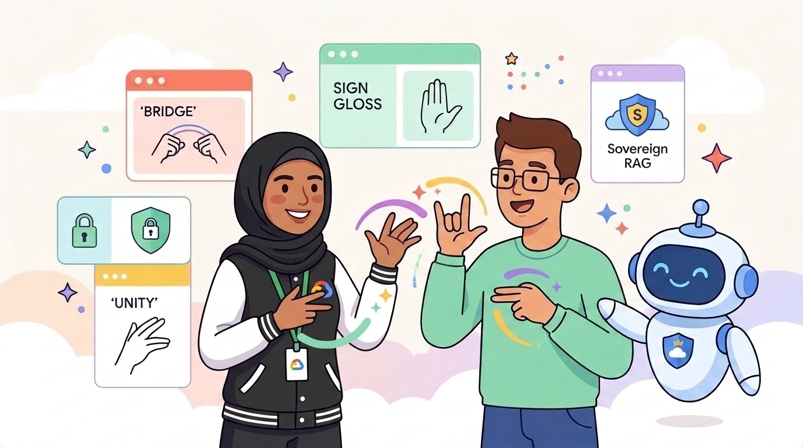

Once you are happy with the Implementation Plan produced during `/grill-me`, instruct **Antigravity (`agy`)** to generate your complete application **from scratch** inside your `signbridge-sovereign-rag` folder:

```text
Proceed with the implementation plan and scaffold the complete SignBridge Sovereign Sign-Language RAG repository from scratch in this directory:
1. vector_store/: BigQuery Vector Search DDL, COSINE VECTOR_SEARCH query helper, init_db.py, and an 8-entry ASL & PSL broadcast/corporate sign lexicon JSON (covering breaking flood news tickers, embargoed Q3 corporate earnings & M&A town halls, 150 bps financial TV desks, "off the record" press idioms, and clinical/ADA protocols).
2. embedding_model/: Cloud Run Dockerfile + FastAPI service baking in EmbeddingGemma 2 via Ollama (/embed returning 768-d vectors) + cloud_run.sh (--no-allow-unauthenticated).
3. llm/: Cloud Run Dockerfile baking in open-weights Gemma 4 via Ollama + cloud_run.sh that checks regional NVIDIA_L4 GPU quota and deploys with --gpu=1 --gpu-type=nvidia-l4 (or falls back to --cpu=8 --memory=16Gi when GPU quota is 0).
4. orchestration/: FastAPI backend (/api/compare, /api/corpus, /health) + colorful Side-by-Side Web UI comparing Baseline Ungrounded LLM vs. Sovereign BigQuery-Grounded SignBridge + root Dockerfile + cloud_run.sh.
5. tests/test_signbridge.py (automated pytest suite) and cleanup.sh for tearing down Cloud Run & BigQuery resources.
```

### Explore Your Newly Generated Codebase
Verify the modular directory tree Antigravity created in your workspace:

1. **Broadcast & Corporate Sign Corpus (`vector_store/sign_lexicon_corpus.json`):** Curated ASL & PSL entries covering breaking flood tickers, embargoed Q3 earnings & M&A town halls, Central Bank `150 bps` rate cuts, and press-room *"off the record"* idioms.
2. **BigQuery Vector Search Query (`vector_store/init_db.py`):** Uses native `VECTOR_SEARCH` with `COSINE` distance:
   ```sql
   SELECT base.doc_id, base.verified_gloss, base.non_manual_markers, distance
   FROM VECTOR_SEARCH(
     TABLE `PROJECT.signbridge_sovereign_rag.sign_lexicon_embeddings`,
     'embedding',
     (SELECT @query_embedding AS embedding),
     top_k => 3,
     distance_type => 'COSINE'
   )
   ORDER BY distance ASC;
   ```
3. **Orchestrator (`orchestration/app.py`):** Queries both an ungrounded prompt and a BigQuery-grounded prompt in parallel so broadcast producers and interpreters can visually verify why grounding prevents live-air errors.

### Run Automated Verification & Optional Push to Your Own GitHub Repo
Run `pytest` locally in Cloud Shell to verify every endpoint before deploying—and optionally push your newly generated project to **your own GitHub account**:

```bash
chmod +x embedding_model/cloud_run.sh llm/cloud_run.sh orchestration/cloud_run.sh cleanup.sh
pytest tests/ -v

# Optional: save & publish your own generated repository to GitHub
git add .
git commit -m "Build SignBridge Sovereign Sign-Language RAG from scratch with Antigravity"
```

---

<!-- ------------------------ -->
## Deploy and Verify the Application
Duration: 10

Now deploy the complete Sovereign Sign-Language RAG stack onto Google Cloud Run!

### 1. Initialize Project & APIs
```bash
source ./setup_env.sh
```

### 2. Deploy the Sovereign `EmbeddingGemma 2` Service
```bash
(cd embedding_model && ./cloud_run.sh)
```

### 3. Initialize BigQuery Vector Search & Ingest Sign Lexicon
```bash
export EMBEDDING_SERVICE_URL=$(gcloud run services describe signbridge-embeddinggemma \
  --project="${PROJECT_ID}" --region="${REGION}" --format="value(status.url)")

python3 vector_store/init_db.py
```

### 4. Deploy Open-Weights `Gemma 4` (Auto GPU / CPU Fallback)
```bash
(cd llm && ./cloud_run.sh)
```

### 5. Deploy the FastAPI Orchestrator & Side-by-Side Web UI
```bash
./orchestration/cloud_run.sh
```

### What Happens During Deployment
* **Cloud Build** packages each microservice and pre-pulls the open-weights `embeddinggemma` and `gemma4:e4b` weights directly into your private **Artifact Registry** image.
* **BigQuery** creates the `signbridge_sovereign_rag.sign_lexicon_embeddings` table inside `europe-west1` and indexes all 768-dimensional vectors.
* **Cloud Run** outputs your live `https://signbridge-rag-ui-...run.app` URL!

---

<!-- ------------------------ -->
## Test the Side-by-Side Web UI and Explore Extensions
Duration: 5


Open the `SignBridge Side-by-Side Web UI Live URL` printed at the end of `./orchestration/cloud_run.sh` in your browser!

### Test These 4 Broadcast & Corporate Scenarios
1. **📺 Breaking News Flood Ticker:** Click *"Breaking News Flood Ticker"*. Notice how the Ungrounded LLM outputs literal word-for-word English (`FLASH FLOOD...`), whereas **SignBridge Sovereign RAG** retrieves `[SL-NEWS-001]` with the rising-wave classifier `[CL:5-rising-wave]` and urgent facial grammar `[intense-eyes, lean-forward]`.
2. **🏢 Embargoed Corporate Earnings & M&A:** Click *"Embargoed Corporate Earnings & M&A"*. Verify that confidential Q3 revenue and *"zero layoffs"* stay inside your GCP project and enforce `[double-O-head-shake]` negation timing (`[SL-CORP-002]`).
3. **📈 Financial TV Desk (PSL 150 bps):** Select `PSL (Pakistan Sign Language)` and test *"Central Bank cut interest rates by 150 basis points"*. Watch SignBridge convert abstract financial jargon into broadcast-clear PSL spatial contrast (`[SL-MEDIA-003]`).
4. **🎙️ Press Briefing Idiom Trap:** Test *"This statement is off the record until 9:00 AM tomorrow"* and confirm SignBridge avoids the classic *"vinyl record"* hallucination (`[SL-MEDIA-004]`).

### Production Extensions for Media & Enterprise Teams
* **Live Newsroom MOS / Teleprompter Webhook:** Connect ENPS or iNEWS teleprompter feeds directly to `/api/compare` so in-studio Deaf interpreters see verified gloss cards on a confidence monitor in real time.
* **VPC Service Controls:** Wrap BigQuery and Cloud Run inside a **VPC Service Controls** perimeter for mathematically enforced zero data exfiltration.
* **3D Avatar & Pose Keypoint Lookup:** Attach verified WLASL / PSL skeletal keypoint clips alongside each `doc_id` in BigQuery!

---

<!-- ------------------------ -->
## Clean Up Resources
Duration: 2

To avoid incurring ongoing Google Cloud charges after completing the Codelab, run the cleanup script to delete the three Cloud Run services and the BigQuery dataset:

```bash
./cleanup.sh
```

Or delete them manually using `gcloud` and `bq`:

```bash
gcloud run services delete signbridge-rag-ui --project="${PROJECT_ID}" --region="${REGION}" --quiet
gcloud run services delete signbridge-gemma4-llm --project="${PROJECT_ID}" --region="${REGION}" --quiet
gcloud run services delete signbridge-embeddinggemma --project="${PROJECT_ID}" --region="${REGION}" --quiet
bq rm -r -f -d "${PROJECT_ID}:signbridge_sovereign_rag"
```

---

<!-- ------------------------ -->
## Congratulations!
Duration: 1

🎉 **Congratulations!** You have architected, verified, and deployed a **Sovereign Sign-Language RAG System (`SignBridge`)** on Google Cloud!

### What You Accomplished
* Planned a privacy-first serverless RAG architecture using **Google Antigravity CLI (`agy`)** and `/grill-me`.
* Generated sovereign **768-d vector embeddings** with **EmbeddingGemma 2** and indexed them in **BigQuery Vector Search**.
* Deployed open-weights **Gemma 4** on **Google Cloud Run** with automatic NVIDIA L4 GPU detection and CPU fallback.
* Built a **Side-by-Side Broadcast Media & Corporate Accessibility Copilot** that eliminates sign-language idiom hallucinations while keeping embargoed scripts 100% inside your cloud boundary!
